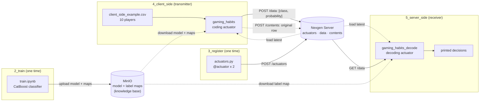

# nexgen-example

An end-to-end example of [Nexgen Server](https://github.com/iamalreadynoob/nexgen-server) and its Python client [nexgenpy](https://github.com/iamalreadynoob/nexgen). It trains a small model, publishes it as a pair of semantic communication (SemCom) actuators, sends classified data from a "client" and reads the decisions back on a "server".

- [What this example does](#what-this-example-does)
- [Basic concepts](#basic-concepts)
- [Repository layout](#repository-layout)
- [Installation](#installation)
- [Configuration](#configuration)
- [How to run](#how-to-run)
- [Updating an actuator](#updating-an-actuator)
- [Troubleshooting](#troubleshooting)
- [Further reading](#further-reading)

---

## What this example does

The use case is **goal-oriented (task-oriented) SemCom** on player data from the [Predict Online Gaming Behavior](https://www.kaggle.com/datasets/rabieelkharoua/predict-online-gaming-behavior-dataset) dataset.

A classic system sends all 11 raw features of a player (age, location, play time, sessions per week, …) to the server, and the server decides what they mean. In this example the client **sends only the meaning**: the predicted engagement level of the player (`High`, `Medium` or `Low`) and its probability. The server does not rebuild the raw features. It uses the decision directly.



## Basic concepts

These are the Nexgen concepts that the example uses. The upstream READMEs explain them in full.

| Concept | What it is | In this example |
|---|---|---|
| **Nexgen Server** | A FastAPI + MongoDB service. It is a registry for actuators and a store for their outputs. It **does not run** actuator code. | Started from `1_deploy/docker-compose-nexgen.yaml` on port `8000` |
| **nexgenpy** | The Python client. It registers, loads and runs actuators. | Installed in the project environment |
| **Actuator** | A named, versioned Python function. Its type is `coding` (transmitter side) or `decoding` (receiver side). | `gaming_habits` (coding, `v1`) and `gaming_habits_decode` (decoding, `v2`) |
| **Data item** | The output of an actuator, stored with the `actuator_id` that made it. | `[predicted_class, probability]` for each player |
| **Content item** | The original input of an actuator, linked to its data item through a random UUID (`linked_resource`). | The original 11 features of each player |
| **Knowledge base** | The shared background knowledge that both sides need to encode and interpret meaning. | The CatBoost model and the JSON label maps in MinIO |

The three nexgenpy operations map to the numbered steps of this repository:

| Operation | nexgenpy API | Step |
|---|---|---|
| **Register** | `@actuator(...)` sends the source of a function to `POST /actuators`. A call to the decorated function registers it. It does not run it. | `3_register` |
| **Load** | `load_actuator(...)` downloads the latest version to `nexgen_actuators/{name}/` and makes a `.venv` with its requirements. `Actuator(...)` does this automatically when the folder is missing. | `4_client_side`, `5_server_side` |
| **Use** | `Actuator(...).run(data)` runs the function **in the current Python process**. With `dst` set, it sends the output to `POST /data` and the input to `POST /contents`. | `4_client_side`, `5_server_side` |

Rules to remember:

- The server stores only the function body. All imports are inside the function, and the model files are downloaded from MinIO at run time.
- The actuator runs in your current Python environment. That is why the project environment has `catboost`, `boto3` and `requests`, and why each side's `.env` has the MinIO credentials.
- The server accepts a data item only from the **latest** version of an actuator.

## Repository layout

```text
nexgen-example/
├── 1_deploy/
│   ├── docker-compose-mino.yml       # MinIO object storage (ports 9000, 9001)
│   └── docker-compose-nexgen.yaml    # Nexgen Server + MongoDB 7 (port 8000)
├── 2_train/
│   └── train.ipynb                   # downloads the dataset, trains CatBoost, uploads to MinIO
├── 3_register/
│   └── actuators.py                  # defines and registers both actuators
├── 4_client_side/
│   └── semantic_communication.py     # transmitter: runs the coding actuator on 10 players
├── 5_server_side/
│   └── fetch_output.py               # receiver: runs the decoding actuator, prints decisions
├── resources/                        # created by train.ipynb (git-ignored)
├── pyproject.toml / uv.lock
└── requirements.txt
```

Each step folder has its own `.env.example`. The folders `resources/`, `nexgen_actuators/`, `catboost_info/` and the downloaded dataset are git-ignored. The steps create them.

## Installation

### Requirements

- Python **3.12** or later
- Docker and Docker Compose
- Jupyter, or an editor that runs notebooks (for example VS Code). The project installs `ipykernel` only.
- Internet access for the Kaggle dataset, the Docker images and the PyPI packages

### 1. Clone and make an environment

```bash
git clone <this-repo-url> nexgen-example
cd nexgen-example

python3.12 -m venv .venv
source .venv/bin/activate
pip install -r requirements.txt
```

`requirements.txt` installs `nexgenpy` from [PyPI](https://pypi.org/project/nexgenpy/), with `catboost`, `boto3`, `pandas`, `scikit-learn`, `kagglehub`, `python-dotenv` and `ipykernel`.

> [!NOTE]
> **With uv:** `pyproject.toml` gets `nexgenpy` from a local wheel, `nexgenpy-1.0.0-py3-none-any.whl`, in the project root. Put the wheel there first (build it from the [nexgen](https://github.com/iamalreadynoob/nexgen) repository or download it from PyPI), then run `uv sync`. Without the wheel, `uv sync` fails. Use the `pip` commands above.

### 2. Start the infrastructure

The example needs two services: **MinIO** for the model files, and **Nexgen Server** for the actuators and their records.

Make `1_deploy/.env` for the Nexgen Server compose file:

```dotenv
MONGO_ROOT_USERNAME="nexgen"
MONGO_ROOT_PASSWORD="change-me"
API_KEY="my-example-key"
# Optional
MONGODB_DB="nexgen"
API_PORT=8000
```

If `API_KEY` is empty, the API is open to all callers. For a shared network, always set a key.

Start both stacks from the `1_deploy` folder:

```bash
cd 1_deploy
docker compose -f docker-compose-mino.yml up -d
docker compose -f docker-compose-nexgen.yaml up -d
cd ..
```

Check them:

```bash
curl http://localhost:8000/api/v1/health
# {"status":"ok"}
```

- The MinIO console is at <http://localhost:9001>. The default user and password are `minioadmin` / `minioadmin`.
- The interactive API documentation of Nexgen Server is at <http://localhost:8000/docs>.

## Configuration

Copy the template in each step folder and fill it in:

```bash
for d in 2_train 3_register 4_client_side 5_server_side; do cp $d/.env.example $d/.env; done
```

| Variable | Used in | Value |
|---|---|---|
| `NEXGEN_BASE_URL` | 3, 4, 5 | `http://localhost:8000/api/v1` |
| `NEXGEN_API_KEY` | 3, 4, 5 | The same value as `API_KEY` in `1_deploy/.env` |
| `MINIO_ENDPOINT` | 2, 4, 5 | `http://localhost:9000` |
| `MINIO_ACCESS_KEY` / `MINIO_SECRET_KEY` | 2, 4, 5 | `minioadmin` / `minioadmin`, unless you changed them |
| `MINIO_REGION` | 2, 4, 5 | `us-east-1` |
| `MINIO_BUCKET` | 2, 4, 5 | `nexgen-example` |
| `MINIO_MODEL_KEY` | 2, 4, 5 | `catboost_model.cbm` |

> [!IMPORTANT]
> `4_client_side/.env.example` does not have `MINIO_ENDPOINT`. Add `MINIO_ENDPOINT=http://localhost:9000` to `4_client_side/.env`. Without it, `boto3` tries to download the model from AWS S3 and fails.

## How to run

Run each step **from its own folder**. The notebook uses `../resources/` paths, and nexgenpy writes `nexgen_actuators/` into the current working directory.

### Step 1: Deploy

See [Start the infrastructure](#2-start-the-infrastructure).

### Step 2: Train the model

Open `2_train/train.ipynb` with the project environment as the kernel, and run all cells.

The notebook:

1. Downloads the Kaggle dataset into `2_train/online-gaming-behavior-dataset/`.
2. Keeps the first 10 rows as `resources/client_side_example.csv`. These 10 players are not used for training. Step 4 sends them.
3. Encodes the text columns as integers and saves each mapping as JSON in `resources/` (`gender_map.json`, `location_map.json`, `game_genre_map.json`, `game_difficulty_map.json`, `engagement_level_map.json`).
4. Trains a `CatBoostClassifier` on an 80/20 stratified split.
5. Uploads the model and the 5 maps to the `nexgen-example` bucket in MinIO. It makes the bucket if it does not exist.

**What to expect:** the notebook prints the accuracy, MCC, precision, recall and F1 score on the test split, and then `Model saved to s3://nexgen-example/catboost_model.cbm`. In the MinIO console, the bucket has 6 objects.

### Step 3: Register the actuators

```bash
cd 3_register
python actuators.py
cd ..
```

This sends the two decorated functions to Nexgen Server:

| Actuator | Type | Version | Input | Output |
|---|---|---|---|---|
| `gaming_habits` | `coding` | `v1` | The 11 player features | `[predicted_class, probability]` |
| `gaming_habits_decode` | `decoding` | `v2` | Nothing | Prints the latest decisions |

**What to expect:**

```text
... [INFO] __main__: Actuator registered: True
... [INFO] __main__: Actuator registered: True
```

The nexgenpy request logs also appear. If you run the step again with the same versions, the server rejects the duplicates (`409 Conflict`) and the script logs `Actuator registered: False`. This is normal. See [Updating an actuator](#updating-an-actuator).

You can see the actuators on the server:

```bash
curl -H "X-API-Key: my-example-key" "http://localhost:8000/api/v1/actuators?latest=true"
```

### Step 4: Run the client side (transmitter)

```bash
cd 4_client_side
python semantic_communication.py
cd ..
```

The script makes an `Actuator("gaming_habits", dst=NEXGEN_BASE_URL, dst_save_original=True)` and runs it on each of the 10 rows in `resources/client_side_example.csv`.

**What to expect:**

- **First run only:** nexgenpy downloads the actuator to `4_client_side/nexgen_actuators/gaming_habits/` (`card.json`, `method.py`, `requirements.txt`) and makes a `.venv` in it. The `pip install` output for `catboost` and `boto3` appears. This can take a minute.
- The first call to the actuator downloads the model and the maps from MinIO into `nexgen_actuators/gaming_habits/actuator_resources/`. The next runs use the local copy.
- For each player, the server receives:
  - a **data item**: `metadata = [predicted_class, probability]`, `actuator_id` = the id of `gaming_habits`, `linked_resource` = a new UUID.
  - a **content item**: `identifier` = the same UUID, `specs` = the original 11 features. It is sent in a background thread.
- The script does not configure logging, so it prints nothing after the setup. To see each request, add `logging.basicConfig(level=logging.INFO)` at the top of the script.

### Step 5: Run the server side (receiver)

```bash
cd 5_server_side
python fetch_output.py
cd ..
```

The script loads and runs `gaming_habits_decode`. The decoding actuator:

1. Downloads `engagement_level_map.json` from MinIO and reverses it (`0 → High`, `1 → Low`, `2 → Medium`).
2. Gets the id of the **latest** `gaming_habits` actuator with `GET /actuators/gaming_habits/latest`.
3. Gets the 10 newest data items of that actuator with `GET /data?actuator_id=...&limit=10`.
4. Prints one line for each item.

**What to expect** (the values below are only an illustration):

```text
2026-10-24T12:31:07.412000Z | 0b6f3c2e-5c1a-4f0e-9d7a-2a8c1e4b9f10 | Medium (93.41%)
2026-10-24T12:31:07.388000Z | 7e2d9a14-8b3f-4c55-a1e2-6f0d4c7b2a93 | High (88.02%)
...
```

- The newest items are first, so the order is the reverse of the CSV.
- The second column is the `linked_resource`. Use it to find the original input in the contents collection.
- `resources/client_side_example.csv` keeps the true `EngagementLevel` of each player. Compare it with the printed decisions.
- The first run makes `5_server_side/nexgen_actuators/gaming_habits_decode/`, as in step 4.
- `fetch_output.py` also has `dst` set. Thus each run also stores one data item for `gaming_habits_decode` (with `metadata: null`, because the function returns `None`) and one empty content item. This does not change the output.

### Look at the stored records

```bash
# Data items made by the coding actuator
curl -H "X-API-Key: my-example-key" "http://localhost:8000/api/v1/data?limit=10"

# Original inputs
curl -H "X-API-Key: my-example-key" "http://localhost:8000/api/v1/contents"
```

The [Nexgen Server API reference](https://github.com/iamalreadynoob/nexgen-server/tree/main/docs/api) gives all endpoints and filters.

## Updating an actuator

1. Change the function in `3_register/actuators.py` and give it a **new version** (for example `v2` for `gaming_habits`). Keep `is_latest=True`.
2. Run `python actuators.py` again. The new version gets `Actuator registered: True`. The unchanged one gets `False`, which is normal.
3. Update the local copies. `Actuator(..., try_load_actuator=True)` downloads an actuator **only if its folder is missing**. It does not check for a new version. Do one of these:
   - Delete `4_client_side/nexgen_actuators/<name>/` (and the `5_server_side` copy), or
   - Call `nexgenpy.load_actuator("<name>")` from that folder. It compares `card.json` with the server and replaces the copy only if the id or version changed.

The server rejects data from an old version (`404` on `POST /data`). Thus a client with an old copy logs `POST /data failed` until you update it.

If you change the model in step 2, delete `nexgen_actuators/*/actuator_resources/` too. The actuators download the files from MinIO only when they are missing.

## Troubleshooting

| Problem | Cause and fix |
|---|---|
| `uv sync` fails on `nexgenpy` | The local wheel is missing. Use `pip install -r requirements.txt`, or see the [note](#1-clone-and-make-an-environment). |
| `401 Unauthorized` from the API | `NEXGEN_API_KEY` in the step's `.env` is not the same as `API_KEY` in `1_deploy/.env`. An empty `NEXGEN_API_KEY=""` is still sent as a header. |
| `Connection refused` on port 8000 or 9000 | The containers are not running. Run `docker compose -f <file> ps` in `1_deploy`. |
| `NoSuchBucket` or `404` from MinIO | Step 2 did not finish. Run the last cells of the notebook again. |
| `NoCredentialsError` or a request to `amazonaws.com` in step 4 | `MINIO_ENDPOINT` is missing in `4_client_side/.env`. |
| `FileNotFoundError: ../resources/...` | Run the notebook from inside `2_train`. |
| A new `nexgen_actuators/` folder appears in the project root | You ran a script from the wrong folder. Run each step from its own folder. |
| `KeyError` in the coding actuator | A value in the CSV is not in the label maps. Use the same maps that trained the model. |
| `Actuator registered: False` | The name and version already exist. Change the version to publish a new one. |

To stop the services:

```bash
cd 1_deploy
docker compose -f docker-compose-nexgen.yaml down      # add -v to delete the MongoDB data
docker compose -f docker-compose-mino.yml down          # add -v to delete the MinIO data
```

## Further reading

- [nexgenpy](https://github.com/iamalreadynoob/nexgen): [quick start](https://github.com/iamalreadynoob/nexgen/blob/main/docs/quickstart.md), [writing actuators](https://github.com/iamalreadynoob/nexgen/blob/main/docs/writing-actuators.md), [configuration](https://github.com/iamalreadynoob/nexgen/blob/main/docs/configuration.md)
- [Nexgen Server](https://github.com/iamalreadynoob/nexgen-server): [concepts](https://github.com/iamalreadynoob/nexgen-server/blob/main/docs/concepts.md), [configuration](https://github.com/iamalreadynoob/nexgen-server/blob/main/docs/configuration.md), [API reference](https://github.com/iamalreadynoob/nexgen-server/tree/main/docs/api), [security](https://github.com/iamalreadynoob/nexgen-server/blob/main/docs/security.md)
